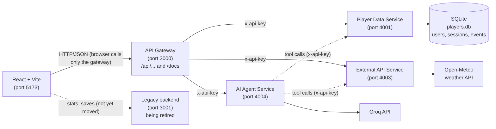
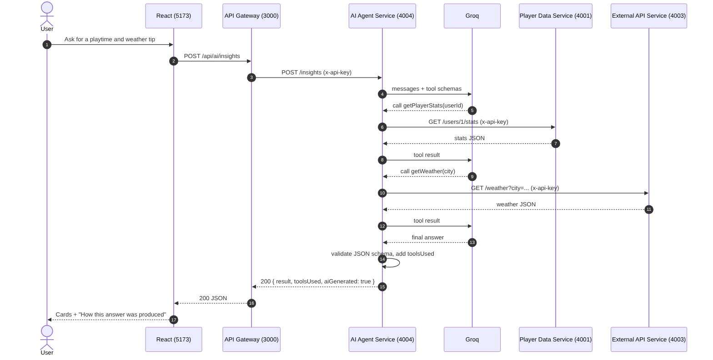

# BlockTogether

> Items marked **TODO** need information from the team. Search for `TODO` before submitting and remove this note.

## 1. Overview

| | |
|---|---|
| **Project** | BlockTogether, a voxel building and minigame web app with player statistics and healthy-play reminders |
| **Group name** | Pixel Conquer Studios |
| **Group number** | Team 8 |
| **Members** | Abdullah Temori, James Parker Strand, Cristian Acevedo-Villasana |
| **Logo** | TODO: add `docs/logo.png` and show it here with `` |
| **Demo video** | `docs/groupname_demo.mp4` (TODO: rename to the final file name) |

**Problem and users.** Young players and casual gamers lose track of how long they have played. BlockTogether lets them build in a shared block world, play minigames, and see their own playtime statistics. A break reminder appears after long play (default: more than 60 minutes in the last 24 hours), and an AI assistant explains their stats.

### Final feature status

| Feature | Status |
|---|---|
| Account login and register (hashed passwords) | Implemented |
| Play sessions and gameplay events (full CRUD) | Implemented |
| Player statistics with break reminder | Implemented |
| Weather lookup (external API) | Implemented |
| AI insights in mock mode | Implemented |
| AI block generator from a text prompt | Partially Implemented (needs a Groq key; still called through the legacy backend) |
| AI agent with tool calling and `toolsUsed` | TODO: update when finished |
| Voxel home world, maze and arena shooter minigames | Implemented (saves still use the legacy backend) |
| React Router views and gateway-only frontend | TODO: update when finished |

### Phase II feedback response

| Phase II feedback | How we addressed it |
|---|---|
| TODO | TODO |

## 2. Architecture

### Service catalog

| Service | Port | Single responsibility | Data owned | Calls | Owner |
|---|---|---|---|---|---|
| React frontend | 5173 | Website and games | none | API Gateway only (target) | James |
| API Gateway | 3000 | Only public entry point: routes, key forwarding, `/api/health`, `/docs` | none | All services | Abdullah |
| Player Data Service | 4001 | Accounts, play sessions, gameplay events, statistics | SQLite `players.db` (users, sessions, events) | none | Abdullah |
| External API Service | 4003 | Weather lookup | none | Open-Meteo APIs | James |
| AI Agent Service | 4004 | AI insights and block generation | none | Groq API; tools call the Player Data and External API services (TODO: confirm when tool calling is merged) | Cristian |
| Legacy backend | 3001 | Old stats and world saving; being retired | `backend/SqlDatabase` (legacy) | none | all |

### Diagrams





The sequence diagram shows the tool-calling design for the AI Agent Service. TODO (Cristian): make sure it matches the final implementation before submitting.

## 3. Data

The Player Data Service owns all player data in SQLite (Node's built-in `node:sqlite`, no native install). SQL lives in `backend/player-data-service/db.js` and uses only parameterized queries. No other service reads this database.

| Table | Fields |
|---|---|
| `users` | `id`, `username` (unique), `password_hash` (scrypt, never plain text), `created_at` |
| `sessions` | `id`, `user_id` (references users), `game`, `started_at`, `ended_at`, `duration_minutes` |
| `events` | `id`, `session_id` (references sessions), `type` (position, block_placed, block_broken, entity_kill), `x`, `y`, `z`, `created_at` |

A user has many sessions, and a session has many events (deleting a session deletes its events).

**Sample records** (from `npm run seed`, which creates 6 users, 26 sessions and 117 events):

```json
{ "id": 1, "username": "demo_player", "createdAt": "2026-11-20T..." }
{ "id": 1, "userId": 1, "game": "home-world", "startedAt": "2026-11-20T03:08:23Z", "endedAt": "2026-11-20T03:43:23Z", "durationMinutes": 35 }
{ "id": 1, "sessionId": 1, "type": "position", "x": -2, "y": 1, "z": 15 }
```

**Why SQLite:** it gives real relations and constraints, needs no server, and lives in one generated file, so graders can run the project immediately. For production we would move to a hosted database such as MySQL and keep the same query module.

The generated `players.db` is not committed. Running `npm run seed` recreates it.

## 4. API

All public routes are on the gateway at `http://localhost:3000`. Interactive documentation (Swagger UI, "Try it out" works):

| Service | Swagger UI |
|---|---|
| API Gateway (complete public API) | http://localhost:3000/docs |
| Player Data Service | http://localhost:4001/docs |
| External API Service | http://localhost:4003/docs |
| AI Agent Service | TODO (Cristian): add `openapi.yaml` and `/docs` |

| Method | Public path | Service | Purpose |
|---|---|---|---|
| GET | `/api/health` | Gateway | Status of every service (503 if one is down) |
| POST | `/api/register` | Player | Create an account |
| POST | `/api/login` | Player | Log in |
| GET, POST | `/api/players` | Player | List or create players |
| GET | `/api/players/:id` | Player | One player |
| GET | `/api/players/:id/stats` | Player | Playtime, averages, event counts, break reminder |
| GET, POST | `/api/sessions` | Player | List or start sessions |
| GET, PATCH, DELETE | `/api/sessions/:id` | Player | Read, end or delete a session |
| GET, POST | `/api/sessions/:id/events` | Player | List or add gameplay events |
| GET | `/api/weather?city=&state=&country=` | External | Weather from Open-Meteo |
| POST | `/api/ai/insights` | AI | AI summary of player stats |
| POST | `/api/ai/blocks` | AI | Block list from a text prompt |

**Errors** always use one shape: `{ "error": "message" }`, with 400, 401, 404, 409 for bad input, 502 when the gateway cannot reach a service, and 503 when the AI provider is unavailable.

**Service-to-service composition.** The gateway adds the internal `x-api-key` header to every request and passes each service's status code and body back unchanged. Every service route except `GET /health` and `/docs` returns 401 without that key. TODO (Cristian): describe the AI tool calls that read data from the Player Data and External API services.

**OpenAPI lint** (`npm run lint:api`): all three specifications pass.

```text
backend/api-gateway/openapi.yaml: validated
backend/player-data-service/openapi.yaml: validated
backend/external-api-service/openapi.yaml: validated
Woohoo! Your API descriptions are valid.
```

## 5. AI Agent

TODO (Cristian): replace this section with the final design. Required content:

- **User task:** TODO (for example, "explain my playtime and suggest a break plan").
- **Tools** (each calls another service with `x-api-key`):

| Tool | Purpose | Arguments | Calls |
|---|---|---|---|
| TODO `getPlayerStats` | Read the player's statistics | `userId` | Player Data Service `GET /users/:id/stats` |
| TODO `getWeather` | Read the weather for a city | `city` | External API Service `GET /weather` |

- **Output schema:** TODO (also shown in the gateway and AI service `openapi.yaml`).
- **Sample `toolsUsed` trace:** TODO.
- **Guardrails:** TODO (step limit, input length limit, timeout, 429/503 messages, mock mode `AI_MODE=mock`).
- **Limitations and ethics:** AI text can be wrong, so the UI labels it as AI-generated; the assistant only reads gameplay statistics (no personal data beyond a username); players should not rely on it for health advice.

What exists today: `POST /insights` (mock or Groq summary of stats) and `POST /aipromptblocksgenerator` (Groq block list), both behind the gateway.

## 6. Setup and Run

**Prerequisites:** Node.js 24 or newer (the services use Node's built-in `node:sqlite`; Node prints an "experimental" warning, which is expected). No database to install.

```sh
git clone <repository link>
cd <repository folder>
npm run install-all     # installs the root, every service and the frontend
npm run seed            # creates and fills the Player Data Service database
npm run start:services  # starts the Player Data, External API, AI Agent services and the gateway
```

In a second terminal start the website:

```sh
npm start               # Vite at http://localhost:5173
```

TODO: replace the two start steps with a single `npm start` once the root script starts the services and the website together.

**Environment files.** Copy each `.env.example` to `.env` only if you want to change a value. Defaults work out of the box, and the AI service runs in mock mode without a key.

| File | Variables |
|---|---|
| `backend/api-gateway/.env.example` | `PORT=3000`, `SERVICE_API_KEY=tcss460-secret`, `PLAYER_URL=http://localhost:4001`, `EXTERNAL_API_URL=http://localhost:4003`, `AI_AGENT_URL=http://localhost:4004` |
| `backend/player-data-service/.env.example` | `PORT=4001`, `SERVICE_API_KEY`, `BREAK_AFTER_MINUTES=60` |
| `backend/external-api-service/.env.example` | `PORT=4003`, `SERVICE_API_KEY` |
| `backend/ai-agent-service/.env.example` | `PORT=4004`, `SERVICE_API_KEY`, `AI_MODE=mock`, `GROQ_API_KEY=`, `GROQ_MODEL=openai/gpt-oss-20b` |

**URLs:** website `http://localhost:5173`, gateway `http://localhost:3000`, health `http://localhost:3000/api/health`.

**Port already in use?** Stop old copies with `kill -9 $(lsof -ti :3000 -ti :4001 -ti :4003 -ti :4004)` (macOS or Linux) and start again.

### How to test the main features

1. Open `http://localhost:3000/api/health`. Every service should say `up`.
2. Open `http://localhost:5173` and log in with `demo_player` / `password123` (all seeded users use this password), or register a new account.
3. Open the player home, maze or arena shooter from the website and play. Click the game to capture the mouse, move with WASD, jump with Space, and press Esc to release.
4. Open `http://localhost:3000/docs` and use "Try it out" on `GET /api/players/1/stats`. The demo player has a break reminder.
5. Try `GET /api/weather?city=Tacoma&state=Washington&country=US`.
6. Stop the External API Service and call the weather route again: the gateway answers 502 with a friendly message and the rest of the app keeps working.

## 7. Testing

Run with the services started: `npm run test:api` (Node's built-in test runner, file `backend/api-tests/gateway.test.mjs`). Test 10 needs the External API Service stopped: `EXPECT_EXTERNAL_DOWN=1 npm run test:api`. Last run: all passed.

| # | Request | Expected | Actual | Result |
|---|---|---|---|---|
| 1 | `GET /api/players/1/stats` | 200, stats with break reminder | 200, stats returned | pass |
| 2 | `POST /api/register`, then `POST /api/login` | 201, then 200 | 201, then 200 | pass |
| 3 | `POST /api/sessions` with `{}` | 400 (userId required) | 400 | pass |
| 4 | `POST /api/login` with a wrong password | 401 | 401 | pass |
| 5 | `GET /api/players/9999` | 404 | 404 | pass |
| 6 | `POST /api/register` with a taken username | 409 | 409 | pass |
| 7 | `POST`, `PATCH`, `DELETE /api/sessions` | 201, 200, 204, then 404 on read | as expected | pass |
| 8 | `POST /api/ai/insights` (`AI_MODE=mock`) | 200, mode `mock` | 200, mode `mock` | pass |
| 9 | `GET /api/weather` without a city | 400 | 400 | pass |
| 10 | `GET /api/weather` with the External API Service stopped | 502 | 502 | pass |
| 11 | `GET http://localhost:4001/users` without `x-api-key` | 401 | 401 | pass |
| 12 | `GET http://localhost:4003/weather` without `x-api-key` | 401 | 401 | pass |
| 13 | `GET /docs` on the gateway, Player Data Service and External API Service | 200 | 200 | pass |

The original game tests (maze, entities, saves) run with `npm test`. TODO: confirm they still pass after the legacy backend is removed.

## 8. Team

### Contributions and service ownership

| Member | Contributions |
|---|---|
| Abdullah Temori | API Gateway, Player Data Service (database, seed, CRUD, login), OpenAPI and Swagger for the gateway and both data services, API tests, service catalog and README data and API sections |
| James Parker Strand | TODO: website and minigames, weather (External API) service, React views |
| Cristian Acevedo-Villasana | TODO: gameplay tracking, AI Agent Service |

### AI Assistance

TODO (all members): list the AI tools used (for example, Claude), what they helped with, which AI-suggested code was reviewed and how, and what each of you implemented and tested yourselves. Note for Abdullah: Claude helped plan and write the API Gateway, Player Data Service, login, OpenAPI files, tests and this README; Abdullah ran, tested and committed all of it and can explain every service he owns.

### Final Sprint Review

TODO (Sprint 3, same headings as the status reports): Team Status, Sprint Goal, Service Status, Summary of Progress, Backlog Status, Who Did What, Risks and Challenges, Next Steps, plus a short retrospective (what went well, what did not, what we would change).

### Challenges and future work

TODO: add team challenges. Known work left today: move stats, world saving and the AI block generator from the legacy backend to the gateway, then remove the legacy backend; add React Router views; add AI tool calling.
